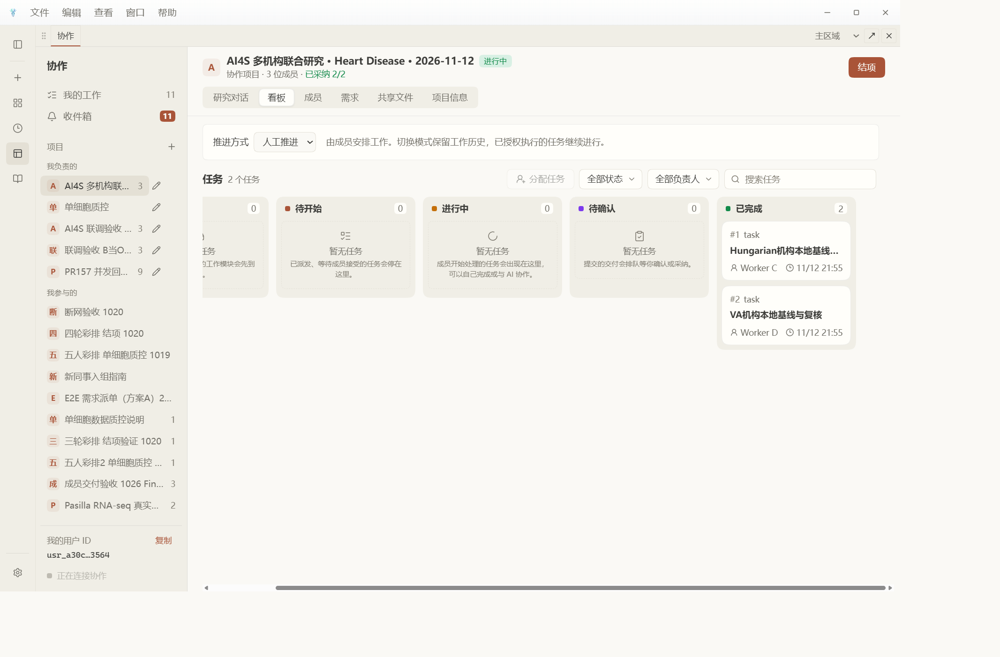
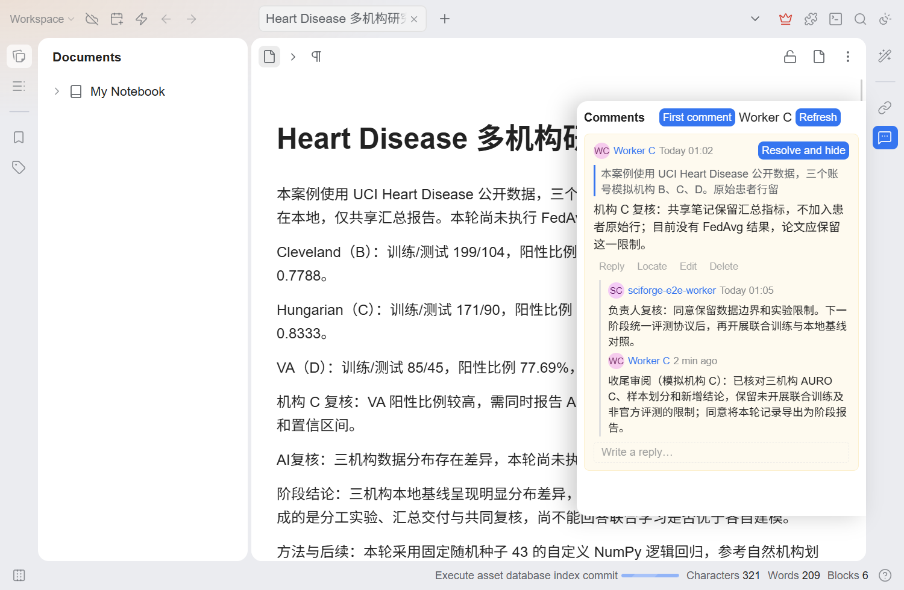

# SciForge：机构分区 Heart Disease 协作分析

**本地分类建模与交叉审阅｜案例作者：张泽宇（MultiHugo）**

使用 UCI Heart Disease 的 Cleveland、Hungarian 与 VA 三个机构分区，建立本地逻辑回归基线，并通过 SciForge 完成任务分工、结果提交、评论审阅和共同研究记录修订。一名操作者在单机上控制三个测试账号；这是协作流程案例，尚未开展联邦训练或验证真实跨机构数据隔离。

- [中文案例报告](docs/case-study.zh-CN.md)
- [English case report](docs/case-study.en.md)
- [方法与复现说明](METHODS.md)
- [历史共享研究记录](provenance/shared-research-note-20261113.md)
- [原始三组汇总结果](results/original/)
- [2026-11-22 VA 补充核查](results/supplementary/va-test-distribution-20261122.json)

## 主要结果

阳性比例按清洗后全部保留样本统计；AUROC 和准确率来自各自测试集。不同机构测试集不同，数值不作为模型优劣的直接排名。

| 分区 | 保留样本 | 训练 / 测试 | 全部保留样本阳性比例 | 测试 AUROC | 测试准确率 |
|---|---:|---:|---:|---:|---:|
| Cleveland | 303 | 199 / 104 | 45.87% | 0.8787 | 0.7788 |
| Hungarian | 261 | 171 / 90 | 37.55% | 0.9044 | 0.8333 |
| VA | 130 | 85 / 45 | 77.69% | 0.5629 | 0.7556 |

**代表发现：VA 的准确率不能单独说明模型有效。** 2026-11-22 补充复算确认：测试集 45 例中 35 例阳性（77.78%）；模型在 0.5 阈值下预测 38 例阳性（84.44%）。模型准确率 75.56%，低于全部预测为阳性的基线 77.78%；AUROC 为 0.5629。该核查晚于原始协作演示，不将它写作当时已完成的讨论。

## 复现

建议使用 Python 3.11 或更新版本及独立虚拟环境；原结果使用 NumPy 2.4.1。

```bash
python -m pip install -r requirements.txt
python scripts/reproduce.py
```

运行时从 UCI 下载三个公开数据文件到 `reproduced/`，检查原始数据和分析脚本 SHA-256，再运行原脚本并核对全部分区的样本数、AUROC、准确率以及 VA 预测分布。结果写到 `reproduced/`，不覆盖历史结果；不需要 GPU、SciForge 账号或服务器凭据。此命令复现数值分析，协作界面操作由图文和历史记录提供证据。

## 研究与审阅



图 1｜负责人查看 Hungarian 与 VA 的已完成任务和汇总材料。



图 2｜成员在共同研究记录旁讨论 VA 指标解释、数据共享范围及后续评测方向。截图来自原演示，未包含后续 VA 补算。

## 数据、范围与来源

原始数据不随仓库发布；复现脚本从 UCI 获取公开数据。实验中的“仅共享汇总结果”描述项目内的材料交换约定，不代表已通过访问隔离或隐私技术验证。自定义 NumPy 逻辑回归并非官方 FLamby 分数，未执行联合/联邦模型对照、置信区间或显著性检验，不用于临床决策。

数据引用：Janosi, A., Steinbrunn, W., Pfisterer, M., & Detrano, R. (1989). *Heart Disease*. UCI Machine Learning Repository. [DOI: 10.24432/C52P4X](https://doi.org/10.24432/C52P4X)。[UCI 数据页面](https://archive.ics.uci.edu/dataset/45/heart+disease)标注数据许可为 CC BY 4.0；数据权利归原权利人。

仓库组织参考：[转录组与单细胞联合分析案例](https://github.com/jiweichen28-web/sciforge-transcriptomics-singlecell)、[Lean 与 CUDA 案例](https://github.com/zx070326-hash/sciforge-lean-cuda-cases)。分析与结果来自本案例自身运行。

## 作者与贡献

- **张泽宇（[MultiHugo](https://github.com/MultiHugo)）**：案例设计、研究组织、人工测试与最终确认。
- **[OpenAI Codex](https://github.com/codex)（AI 辅助工具）**：分析脚本编写、实验执行与结果复核、中英文材料整理及仓库发布。

Git 提交以 MultiHugo 为主作者，并通过 `Co-authored-by: Codex <codex@openai.com>` 标注 Codex 的辅助贡献。
