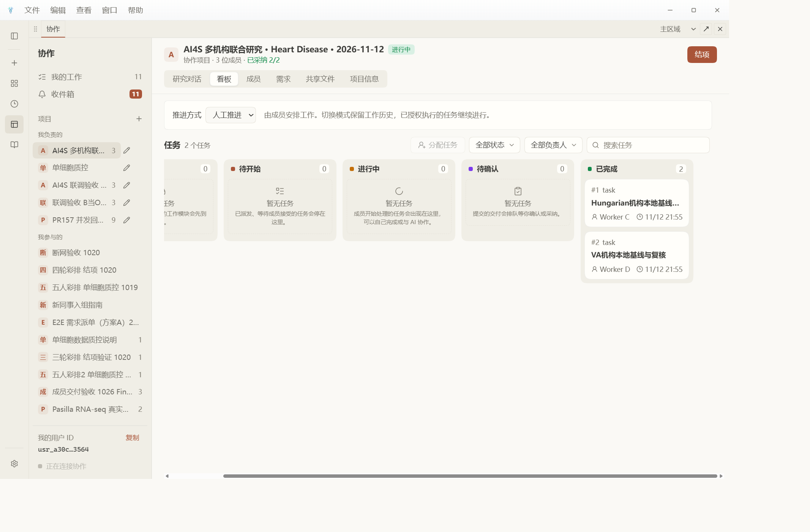
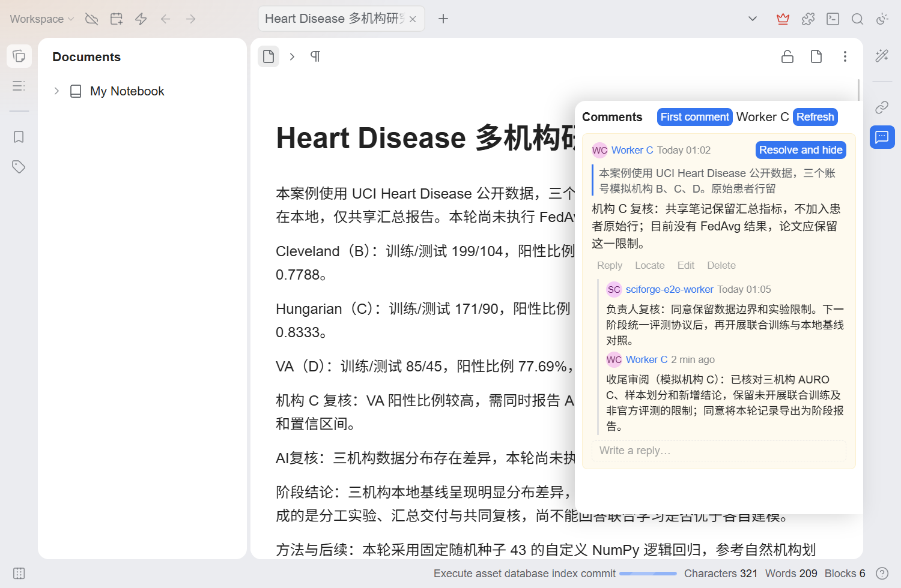

# Collaborative Analysis of Institutional Heart Disease Partitions: Local Classification and Cross-review

Case author: Zeyu Zhang (张泽宇 / MultiHugo)

## Research setting

This case uses the Cleveland, Hungarian, and VA partitions of the UCI Heart Disease dataset to establish local classification baselines and examine their interpretation through cross-review. One operator controlled three SciForge test accounts on a single machine: lead B analyzed Cleveland and integrated the shared research note; member C analyzed Hungarian and reviewed the results; member D analyzed VA. Data were processed in separate working directories, while the project exchanged method descriptions, aggregate metrics, and research notes. This arrangement simulated research handoffs; it did not establish real institutional data isolation.

## Execution

All roles used a custom NumPy logistic regression workflow with random seed 43, class-stratified train/test splitting, and standardization parameters estimated from training data only. After local CPU-based cleaning, training, and evaluation, members submitted their methods and aggregate results to the project. Lead B reviewed and accepted the submissions from C and D, then integrated all three baselines into the shared research note (Figure 1).

During cross-review, C highlighted VA's test accuracy of 0.7556 alongside an AUROC of only 0.5629. The team added context on class composition and metric interpretation, retained the statement that federated training had not been performed, and identified aligned evaluation and additional statistical checks as follow-up work. Members reviewed the revised note (Figure 2). The VA test-label and prediction distributions below were recomputed later, on 2026-11-22; they were not part of the original demonstration.

## Main results

The table reports positivity across all retained samples after cleaning; AUROC and accuracy are computed on each partition's own test set. These different test sets do not support a direct ranking of model performance.

| Partition | Retained samples | Train / test | Positivity, all retained samples | Test AUROC | Test accuracy |
|---|---:|---:|---:|---:|---:|
| Cleveland | 303 | 199 / 104 | 45.87% | 0.8787 | 0.7788 |
| Hungarian | 261 | 171 / 90 | 37.55% | 0.9044 | 0.8333 |
| VA | 130 | 85 / 45 | 77.69% | 0.5629 | 0.7556 |

VA provided the clearest reason for further investigation. The later recomputation found 35 positive labels among 45 test samples (77.78%); at a threshold of 0.5, the model predicted 38 samples as positive (84.44%). Its accuracy of 75.56% was below the 77.78% obtained by predicting every test sample as positive, while AUROC was 0.5629. Thus, accuracy near 76% did not establish useful classification performance. This check supplied additional quantitative support for the concern raised during review, although the causes of the weak performance require further experiments.

## Case value and scope

The case completed independent analysis of three partitions, result submission, cross-review, and a shared research note. A member's question about VA's metrics led the lead to clarify the interpretation, with discussion and revision retained in the same project. The experiment used one machine, multiple accounts, and a custom implementation. It did not execute federated training, official FLamby evaluation, physical institutional isolation tests, joint-versus-local model comparisons, repeated splits, or confidence intervals.

## Figures

Figure 1. The lead reviews completed Hungarian and VA tasks and submitted materials.

Figure 2. Members discuss VA metric interpretation, the scope of shared materials, and future evaluation. The original screenshot does not contain the later 2026-11-22 analysis.

See [METHODS.md](../METHODS.md) and the [repository overview](../README.md) for data attribution and reproduction instructions.
