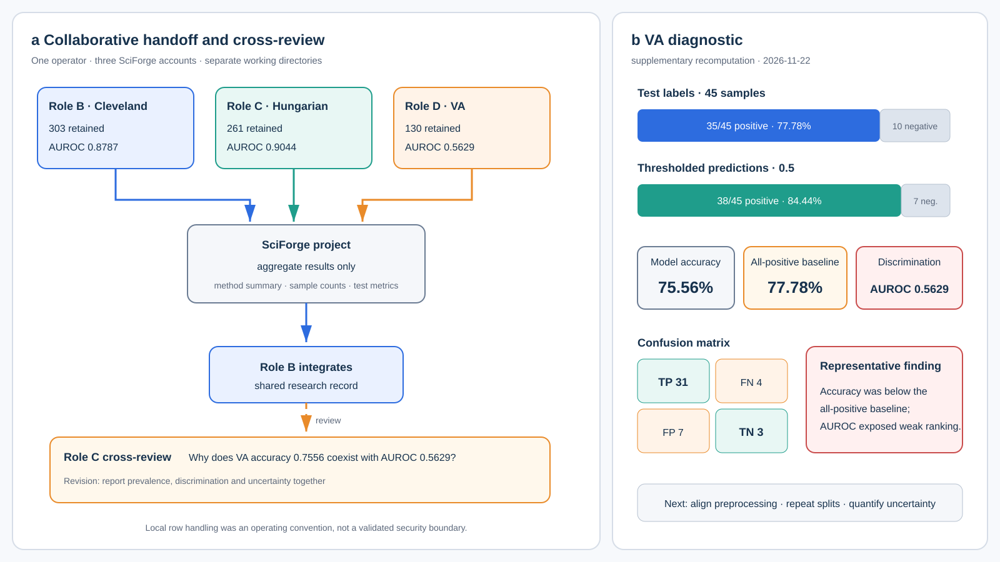

# 当 75.56% 准确率低于单一类别基线

案例作者：张泽宇

## 研究场景

本案例使用 UCI Heart Disease 数据集的 Cleveland、Hungarian 和 VA 三个分区，检验交叉审阅能否发现容易被误读的本地模型结果。一名操作者通过独立的 SciForge 账号和工作目录模拟三个角色：负责人 B 分析 Cleveland 并维护共同研究记录，成员 C 分析 Hungarian 并审阅其他提交，成员 D 分析 VA。项目内交换方法说明、汇总结果和审阅意见，而不交换患者级数据行。

## 执行过程

三个角色均运行相同的自定义 NumPy 逻辑回归流程：固定随机种子 43，按类别分层划分训练集和测试集，并仅使用训练集估计标准化参数。成员 C、D 通过项目任务提交 Hungarian 和 VA 汇总，负责人 B 核对约定流程、接收两份材料，再把三个本地基线整合进同一份研究记录。

在 2026 年 11 月 12—13 日的原始演示中，成员 C 质疑 VA 模型为何达到 0.7556 的测试准确率，而 AUROC 只有 0.5629。这个问题改变了报告：准确率与 AUROC 被同时展示，全部保留样本的阳性比例与测试集指标被明确区分，重复划分或置信区间被列为下一步分析。原项目没有保留 VA 测试标签计数和阈值化预测，因此当时提出了类别比例问题，但尚未给出定量答案。

**图1｜** 原始共同研究记录中对 VA 准确率与 AUROC 差异的审阅。

## 主要结果

下表的阳性比例按清洗后全部保留样本计算，AUROC 与准确率来自每个分区各自的测试集。由于队列和测试集不同，这些数据描述本地结果，不构成受控的模型排名。

| 数据分区 | 保留样本 | 训练 / 测试 | 全部保留样本阳性比例 | 测试 AUROC | 测试准确率 |
|---|---:|---:|---:|---:|---:|
| Cleveland | 303 | 199 / 104 | 45.87% | 0.8787 | 0.7788 |
| Hungarian | 261 | 171 / 90 | 37.55% | 0.9044 | 0.8333 |
| VA | 130 | 85 / 45 | 77.69% | 0.5629 | 0.7556 |

2026-11-22 的单独复算使用哈希核验后的脚本进一步检查 VA 问题。45 个测试样本中有 35 个阳性（77.78%）；模型预测 38 个阳性（84.44%），共正确分类 34 个样本。混淆计数为 31 个真阳性、4 个假阴性、3 个真阴性和 7 个假阳性。因此，模型准确率为 75.56%，低于把所有样本都预测为阳性所得的 77.78%，AUROC 仍为 0.5629。

**图2｜** a 展示原始协作路径；b 展示单独标注日期的 VA 后续核查。

## 案例价值与边界

本案例说明，交叉审阅能够把一个看似令人放心的分数转化为可检验的问题：在比较本地训练与协作训练前，应统一预处理，使用多个随机种子重复划分，报告不确定性，并检查不同阈值下的错误构成。案例不能确定 VA 判别能力较弱的成因。本次演示使用一名操作者、一台 Windows 设备、三个测试账号和自定义 NumPy 模型，没有验证机构隔离，没有开展联邦训练、官方 FLamby 评测、本地与联合模型比较或临床验证。数据与复现材料见 [UCI Heart Disease 数据集](https://doi.org/10.24432/C52P4X)、[公开案例仓库](https://github.com/MultiHugo/sciforge-heart-disease-collaboration)和 [METHODS.md](../METHODS.md)；论文素材汇总在[可直接用于论文的 LaTeX 案例包](../paper/case-02-heart-disease/README.md)中。
