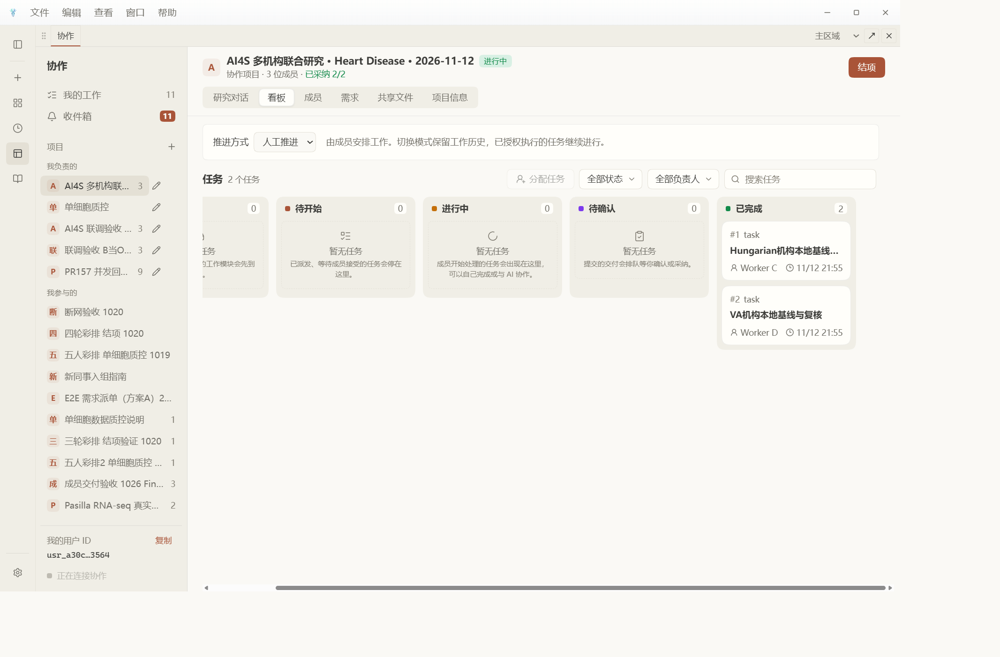
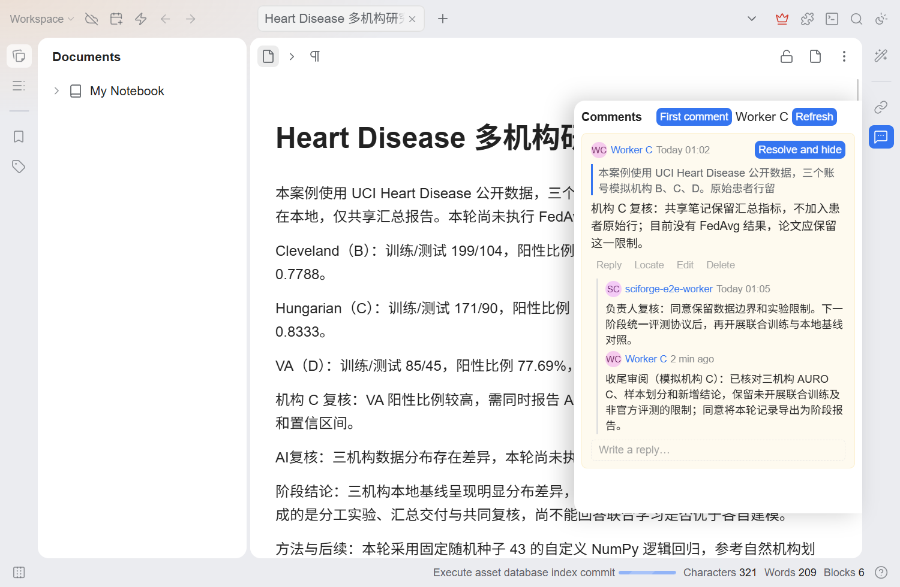

# 机构分区心血管数据的协作分析：本地分类建模与交叉审阅

案例作者：张泽宇

## 研究场景

本案例选取 UCI Heart Disease 中 Cleveland、Hungarian 与 VA 三个机构数据分区，建立本地分类基线，并通过交叉审阅检查指标解释。一名操作者在单机上使用三个 SciForge 测试账号模拟分工：负责人 B 分析 Cleveland 并整合共同研究记录，成员 C 分析 Hungarian 并承担交叉审阅，成员 D 分析 VA。各分区在独立工作目录中处理，项目内仅交换方法说明、汇总指标与研究记录。这一安排模拟跨机构协作中的材料交接，不代表已验证真实机构的数据隔离。

## 执行过程

三名角色均采用自定义 NumPy 逻辑回归流程，固定随机种子 43，按类别分层划分训练集和测试集，并仅使用训练集估计标准化参数。各角色在本地 CPU 上完成清洗、训练和测试指标计算后，将方法与结果提交至协作项目。负责人 B 查看并接收 C、D 的分析产物，将三组结果纳入共同研究记录（图1）。

交叉审阅时，成员 C 指出 VA 的测试准确率为 0.7556，而 AUROC 仅为 0.5629。团队据此补充类别分布与指标解释，保留尚未进行联邦训练的说明，并将统一评测协议和补充统计验证列为后续方向。负责人更新记录后，成员再次核对结果与解释（图2）。以下 VA 测试集构成和预测分布是 2026-11-22 的后续复算，未作为原演示中已经完成的分析。

## 主要结果

三组本地基线见下表。阳性比例按清洗后全部保留样本统计，AUROC 与准确率来自各自测试集。各分区测试集不同，结果不用于直接排名。

| 数据分区 | 保留样本 | 训练 / 测试 | 全部保留样本阳性比例 | 测试 AUROC | 测试准确率 |
|---|---:|---:|---:|---:|---:|
| Cleveland | 303 | 199 / 104 | 45.87% | 0.8787 | 0.7788 |
| Hungarian | 261 | 171 / 90 | 37.55% | 0.9044 | 0.8333 |
| VA | 130 | 85 / 45 | 77.69% | 0.5629 | 0.7556 |

VA 是本轮最值得进一步检查的结果。后续复算确认，45 个测试样本中有 35 个阳性，测试集阳性比例为 77.78%；模型在 0.5 阈值下将 38 个样本预测为阳性，占 84.44%。模型准确率 75.56%，低于全部预测为阳性的简单基线 77.78%，AUROC 为 0.5629。因此约 76% 的准确率不足以说明模型分类效果良好。该结果为审阅中提出的指标解释问题提供了进一步的定量支持，具体成因仍需通过后续实验分析。

## 案例价值

本案例完成了三个分区的独立分析、结果提交、交叉审阅和共同研究记录整理。成员对 VA 指标的质疑促使负责人补充解释，讨论与修订保留在同一项目中。实验使用单机多账号与自定义实现，尚未进行联邦训练、官方 FLamby 评测或真实跨机构隔离验证；本轮也未开展联合模型与本地模型比较、重复划分或置信区间分析。

## 配图

图1｜负责人查看 Hungarian 与 VA 分区的已完成任务和提交材料。

图2｜成员围绕 VA 指标解释、共享材料范围及后续评测方向展开讨论。原演示截图不含 2026-11-22 的补充核查。

数据来源与复现方法见 [METHODS.md](../METHODS.md) 和[仓库首页](../README.md)。
